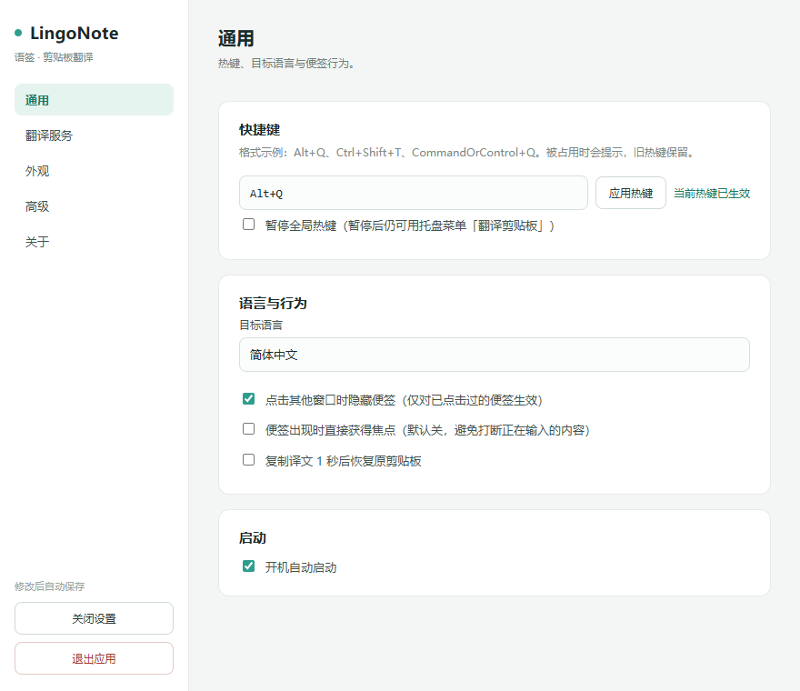

# LingoNote（语签）

[](https://github.com/SeaTownHZ/lingonote/actions/workflows/build.yml)
[](https://github.com/SeaTownHZ/LingoNote/releases)
[](LICENSE)

复制或选中文本，按 `Alt+Q`，在光标旁看译文；再按一次复制译文并收起。

LingoNote 是一个轻量的剪贴板翻译小工具：读取剪贴板文本或当前选中文本，调用你自己配置的 OpenAI 兼容大模型接口，用一张可自定义的便签显示流式译文。无账号、无广告、无遥测。



当前状态：**M4 手感与触发（0.4.0）**。在 M3（更新检查与下载跳转、`v*` tag 自动创建 Draft Release 的发布流水线）基础上，新增选中文本直读、热键录制控件、连按复制译文并关闭、便签拖拽尺寸与钉住、固定位置屏幕取点，以及托盘「最近翻译」（会话内 5 条）；配置仍为增量字段、`schema_version` 保持 2，旧配置可直接读取。构建与单元/集成测试见下文，历史验收记录见 [`docs/M2-验证记录.md`](docs/M2-验证记录.md) 与 [`docs/M3-验证记录.md`](docs/M3-验证记录.md)，版本变更见 [`CHANGELOG.md`](CHANGELOG.md)。macOS 仍为 beta/未验证。

## 已实现

### 核心（M0/M1）

- Tauri 2 应用，Windows 可运行。
- 全局热键（默认 `Alt+Q`）：Rust 侧注册；设置里可修改；冲突时提示并保留旧热键。
- 读取剪贴板纯文本，空内容/超长内容拦截。
- 调用 OpenAI Chat Completions 兼容接口，SSE 流式显示。
- 无边框置顶便签：出现不抢焦点，点击后才聚焦；`Esc` 关闭；再次按热键切换显示。
- 设置窗口：Base URL / API Key / 模型 / 目标语言 / 测试连接。
- API Key 存入系统凭据库（Windows Credential Manager / macOS Keychain），不写入 JSON。
- 外观持久化：背景色、文字颜色、字体、字号、行高；设置页有实时预览。
- 行为设置：失焦隐藏、复制译文后恢复原剪贴板。
- 托盘菜单：翻译剪贴板、设置、退出。
- 开机自启开关。
- DeepSeek 默认预设，可完全自定义。
- 本地 mock SSE 服务，无 API Key 也能验证流式链路。
- NSIS 安装包构建。

### M2 新增

- **单实例**：重复启动只唤起已有实例的设置窗口，不产生第二个托盘图标（`tauri-plugin-single-instance`）。
- **可编辑系统提示词**：用 `{target_language}` 占位；留空/恢复默认使用内置提示词。
- **暂停热键**：设置页与托盘菜单均可暂停/恢复；暂停时热键不触发，托盘「翻译剪贴板」仍可用。
- **本地历史**：默认关闭；开启后最多 200 条（时间、原文、译文、目标语言、模型、耗时），支持搜索、复制译文、删除单条、一键清空；只写本机。
- **配置导入/导出**：JSON；导出不含 API Key；导入校验版本/字段，先备份 `config.backup.json` 再替换，本机 API Key 保留。
- **滚动日志**：默认关闭；仅记录时间、状态与错误，不记录正文；5MB × 3 滚动；设置页可选择 error/info/debug。
- **配置健壮性**：原子写入（临时文件 + rename）；损坏时自动备份为 `config.bad.json`，用默认值启动并在设置页提示。
- **设置页分区**：通用 / 翻译服务 / 外观 / 高级 / 关于；修改后自动保存（API Key 需点「保存 Key」）。
- **外观增强**：5 套主题（便签白/奶油黄/护眼绿/夜间墨/纸质米）、便签圆角。
- **行为增强**：最大字符数可调（1,000–100,000）；「出现时自动聚焦」开关；目标语言 9 种常用预设 + 自定义输入。
- **关于页**：版本、应用标识、配置/历史/日志路径与隐私说明。

### M3 新增（更新与发布）

- **更新检查**：启动后自动检查 GitHub Releases 的最新版本（可在「通用 → 语言与行为」用「启动时检查更新」关闭）；关于页也可手动检查。
- **结果提示**：发现新版本时状态行显示版本号与「下载」入口，点击打开系统浏览器到 Release 页；已是最新或检查失败都有中文状态行，不弹窗、不抢焦点。
- **版本与发布**：三处版本号统一为 `0.3.0`，新增 [`CHANGELOG.md`](CHANGELOG.md)；推送 `v*` tag 自动构建 Windows/macOS 产物并创建 Draft Release。

### M4 新增（手感与触发）

- **选中文本直读**：按热键时优先翻译当前选中文本，不必先 `Ctrl+C`；应用模拟一次复制并在取到后恢复原剪贴板，选区为空或 200ms 内未取到就静默回退剪贴板文本；可在「语言与行为」关闭。
- **热键录制**：设置页「录制」按钮直接按组合键完成绑定（至少一个修饰键，`Esc` 取消），也仍支持手动输入。
- **连按复制并关闭**：便签已有译文时再按热键＝复制译文 + 收起便签 + 「已复制译文」轻提示；可在设置中关闭。
- **便签尺寸与钉住**：右下角拖拽改变宽高（320–900 × 220–900，默认 420×360）并记住；图钉钉住后不再因失焦或点击其他窗口而隐藏。
- **屏幕取点**：固定位置新增「自定义位置」，用只覆盖当前显示器的遮罩点选便签左上角；便签隐藏时会预览 800ms，可随时清除。
- **托盘最近翻译**：会话内最近 5 条成功译文，点击即复制，仅存内存、不落盘。

## 开发环境

- Node.js 20+（本机验证：24）。
- Rust stable（Tauri 2 需要）。
- Windows 10/11；WebView2 Runtime。
- 本机使用 Rust GNU 工具链 + WinLibs，因为机器上没有 MSVC Build Tools；Tauri 官方更推荐 MSVC。若使用 GNU，`src-tauri/Cargo.toml` 的 `crate-type` 需保持 `rlib`（不要用 `cdylib`，否则 MinGW 可能报 `export ordinal too large`）。
- 构建时 PATH 需要包含 `%USERPROFILE%\.cargo\bin` 和 WinLibs 的 `mingw64\bin`。

## 运行

```powershell
npm install
npm run tauri dev
```

首次启动会打开设置。填入 DeepSeek API Key（或使用下面的 mock 服务），保存后关闭设置，选中一段文字（或复制一段文字），按热键。

## 用 mock 服务测试（不消耗 API 额度）

```powershell
npm run mock
# 端口被占用时：
# $env:PORT=8787; npm run mock
```

设置里填：

- Base URL：`http://127.0.0.1:8765/v1`（或你启动时指定的端口）
- API Key：`mock`
- 模型：`mock`

然后复制任意文本，按热键。

mock 服务还提供更新检查用的端点：`GET /repos/SeaTownHZ/LingoNote/releases/latest`（GitHub Release 形状的 JSON，版本由环境变量 `MOCK_TAG` 指定，默认 `v0.3.1`）、别名 `GET /releases/latest`，以及 `GET /stats`（返回两个更新路径的请求总数 `updateRequests`）。两个路径返回内容相同、都计数；本地烟测时把更新 API 指到本机即可：

```powershell
$env:LINGONOTE_UPDATE_API = 'http://127.0.0.1:8765'
```

应用会请求 `{api_base}/repos/SeaTownHZ/LingoNote/releases/latest`，因此烟测请使用完整 GitHub 路径。

## 构建安装包

```powershell
npm run tauri build
```

产物：

- `src-tauri/target/release/lingonote.exe`
- `src-tauri/target/release/bundle/nsis/LingoNote_0.4.0_x64-setup.exe`

## 更新与发布

- **检查更新**：设置页「关于」有「检查更新」按钮；启动后也会自动检查一次（可用「启动时检查更新」关闭）。检查只读取 GitHub Releases 的最新 `tag_name`，不下载、不上传任何数据。
- **下载**：发现新版本时点「下载」会由系统浏览器打开对应的 Release 页面，安装包由你自行下载安装。
- **发版流程**：推送 `v*` tag（如 `v0.4.0`）触发 `.github/workflows/release.yml`，构建 Windows NSIS 安装包与 macOS 压缩包，并以 **Draft Release** 形式创建在对应 tag 下，人工确认说明后再手动发布；普通推送与 PR 只跑 `build.yml` 构建校验。
- **变更记录**：见 [`CHANGELOG.md`](CHANGELOG.md)。

## 测试

```powershell
cd src-tauri
cargo test
```

当前共有 ≥45 个单元/集成测试，覆盖：URL 规范化、HTTP 错误映射、默认/自定义提示词、M0 配置兼容、schema 归一化、API Key 不落盘、导出不含 Key、导入校验、历史上限、原子写入、日志级别/单行化、最大字符数、热键格式解析、M3 的版本归一/比较（`normalize_version`、`is_newer`），以及 M4 的配置增量（`custom` 锚点、便签尺寸与取点坐标）和最近翻译队列，全部通过。

> Windows GNU 工具链下，库测试二进制会因 WebView2Loader 入口点问题无法启动，所以 `[lib] test = false`，测试放在 `src-tauri/tests/` 的纯逻辑目标中。

### UI 烟测（开发期，可选）

发布版默认不开放调试端口。需要脚本化验证界面时，临时通过 WebView2 环境变量启动，再用 `scripts/cdp.mjs` 执行 JS 或截图：

```powershell
$env:WEBVIEW2_ADDITIONAL_BROWSER_ARGUMENTS="--remote-debugging-port=9222"
.\src-tauri\target\release\lingonote.exe
node scripts/cdp.mjs list
node scripts/cdp.mjs eval "document.title"
node scripts/cdp.mjs screenshot docs/images/ui.png
```

该端口只用于本机调试，验证完成后关闭应用即可；不要把带调试端口的进程用于日常使用。

## 手动验收（M2 清单）

M3 的运行时验收见 `docs/M3-验证记录.md`。

1. 设置页可在「通用 / 翻译服务 / 外观 / 高级 / 关于」之间切换；改外观或行为后无需点保存，重启后仍生效。
2. 应用已运行时再次双击 exe：不出现第二个托盘图标，已有设置窗口被唤起。
3. 修改系统提示词（例如「翻译成{target_language}，只输出译文」）后翻译，新提示词生效；点「恢复默认提示词」回到内置文案。
4. 勾选「暂停全局热键」：再按 `Alt+Q` 无反应；托盘菜单「翻译剪贴板」仍可翻译；取消勾选后热键恢复。
5. 高级页开启「保存本地翻译历史」，翻译一条：出现记录（时间/目标语言/模型/耗时）；搜索能过滤；「复制译文」「删除」「清空历史」正常；关闭开关后不再新增。
6. 「导出配置」得到 JSON，搜索不到 `api_key`；「导入配置」应先提示覆盖、生成 `config.backup.json`，导入后设置立即刷新。
7. 开启日志并选 info：翻译后 `logs\app.log` 有请求/完成记录，但不含原文或译文。
8. 手动破坏 `config.json` 后启动：原文件被备份为 `config.bad.json`，应用以默认配置启动，设置页顶部提示。
9. 设置页与托盘菜单的开机自启勾选状态保持同步。
10. 高级页把最大字符数改为 1,000，再复制 1,500 字符文本：提示过长且不发请求。

## 已知限制

- 历史以 `history.json` 保存（需求原写 SQLite `history.db`）；200 条规模无需引入数据库，文件为明文，默认关闭。
- 未实现应用内自动更新（只检查并跳转 Release 页手动下载）、划词/OCR（对应需求 P2/P1 未完成项）。
- 直读依赖模拟 `Ctrl+C`：远程桌面、管理员窗口或禁用复制的控件可能取不到选区，200ms 后静默回退剪贴板；原剪贴板为图片/富文本时只恢复文本部分（日志记降级）。
- 屏幕取点只覆盖光标所在的当前显示器；多屏需切到目标屏重新取点。显示器拔插或分辨率变化后，出现便签前会按工作区夹紧坐标。
- 托盘「最近翻译」仅存本次会话内存（最多 5 条），重启清空，不写入历史文件。
- 日志目录使用 Tauri 的 app log dir（`%LOCALAPPDATA%\com.lingonote.desktop\logs`），不是需求草案里的 `%LOCALAPPDATA%\LingoNote`。
- macOS 尚未在真机验证；CI 工作流见 `.github/workflows/build.yml`（构建校验）与 `.github/workflows/release.yml`（tag 发版）。
- 开机自启在开发模式下会注册 dev exe，正式使用请装安装版；安装版的自启指向安装目录下的 exe。
- GNU 链接警告 `multiple non-default manifests` 仍在，不影响启动。

## 数据位置

- 配置：`%APPDATA%\com.lingonote.desktop\config.json`（不含 API Key）
- 历史：`%APPDATA%\com.lingonote.desktop\history.json`（默认不创建）
- 配置备份：同目录 `config.bad.json`（损坏） / `config.backup.json`（导入或恢复默认前）
- 日志：`%LOCALAPPDATA%\com.lingonote.desktop\logs\app.log`（默认不创建）
- API Key：Windows Credential Manager（服务 `LingoNote`，用户 `api-key`）/ macOS Keychain

## 目录

```
docs/                M0–M3 验证记录与界面截图
design/              LingoNote 图标与生成脚本
src/                 便签 + 设置前端；M4 新增 note.css、settings-extra.css、position-pick.ts
src-tauri/           Tauri/Rust 后端
scripts/             mock SSE 服务
position-pick.html   屏幕取点遮罩页（M4 新增）
CHANGELOG.md         更新日志
```

## 许可

MIT，见 [`LICENSE`](LICENSE)。
