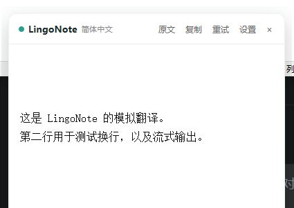
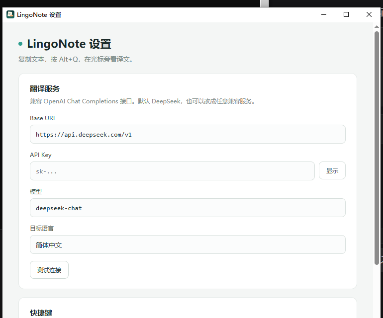

# LingoNote M0 技术验证记录

- 日期：2026-11-12
- 环境：Windows（本机）、Node 24.21.0、Rust 1.99.1（GNU）、MinGW-w64 16.2.0（WinLibs）、WebView2 Runtime 157、Tauri 2.12.5
- 结论：**M0 核心链路跑通**；Windows 安装包已产出；macOS CI 工作流已添加但尚未在真实 macOS 上执行。

## 验证项

| 验证项 | 结果 | 证据 / 备注 |
| --- | --- | --- |
| Tauri 2 应用启动 | ✅ | debug / release 均可启动 |
| 全局热键 `Alt+Q` | ✅ | 启动注册成功；`hotkey registered: Alt+Q` |
| 剪贴板读取 | ✅ | 28 字符测试文本被正确读取 |
| OpenAI 兼容 SSE 流式 | ✅ | 本地 mock 服务，37 字符，约 0.8s 完成 |
| 便签出现在光标附近 | ✅ | 光标右下 12px，越界翻转逻辑已接入 |
| **出现时不抢焦点** | ✅ | 记事本保持前台；日志 `restore foreground ... ok=1` |
| 点击便签后获得焦点 | ✅ | 点击后前台进程变为 `lingonote` |
| **Esc 关闭（已聚焦）** | ✅ | `hide_note command`，窗口隐藏 |
| 再次按热键切换显示/隐藏 | ✅ | 前端 `noteVisible` 状态控制 |
| 设置窗口 | ✅ | 首次无 Key 时由 Rust setup 自动打开；表单可加载配置 |
| NSIS 安装包 | ✅ | `LingoNote_0.1.0_x64-setup.exe`，约 5.63 MiB；静默安装到临时目录后成功启动 |
| 安装包内容 | ✅ | 包含 `lingonote.exe`、`WebView2Loader.dll`、`uninstall.exe` |
| 安装版启动 | ✅ | 安装目录下 exe 可启动并打开设置 |
| macOS CI 构建 | ⏳ | `.github/workflows/build.yml` 已添加，未实际运行 |

## 界面截图

便签（mock 翻译结果）：

设置窗口：

## 踩坑与处理

| 问题 | 处理 |
| --- | --- |
| crates.io 直连超时 | 本地 `.cargo/config.toml` 使用 rsproxy 稀疏镜像；该文件已加入 `.gitignore` |
| GNU 工具链链接 `cdylib` 报 `export ordinal too large` | `crate-type` 改为 `["rlib"]`；桌面端只需 rlib |
| Vite 监视 `src-tauri` 下 Cargo 临时文件导致 EBUSY 崩溃 | Vite `server.watch.ignored` 排除 `src-tauri`、`target`、`.tools` |
| Tauri 的 `window.hide()` 对 Win32 显示过的窗口不生效 | `hide_note` 直接调用 Win32 `ShowWindow(SW_HIDE)` |
| `SW_SHOWNOACTIVATE` 后 WebView2 仍异步抢焦点 | 显示后 150ms 再 `SetForegroundWindow(原前台窗口)`，仅在便签仍为前台时执行 |
| `identifier` 以 `.app` 结尾 | 改为 `com.lingonote.desktop` |
| release 版首次启动时 JS 早于 settings 窗口创建，`open_settings` 报“窗口不存在” | 首次启动改由 Rust `setup` 打开设置；JS 不再抢跑创建；按需创建会卡住，已回退 |
| GNU 链接警告 `multiple non-default manifests` | 当前不影响启动；后续换 MSVC 工具链时复查 |
| 发布版热键复测受本机炉石传说键盘钩子干扰 | 调试版 + 记事本前台已验证“不抢焦点”；发布版同一路径，待干净环境复测 |

## 已知限制

- API Key 明文存于 `%APPDATA%\com.lingonote.desktop\config.json`；M1 接 DPAPI/Keychain。
- 热键固定 `Alt+Q`，不可在设置中修改。
- 无托盘、历史、开机自启、自动更新。
- 便签高度固定 360px；长文本内部滚动。
- `debug_log` 仅用于 M0 调试，M1 已移除。
- macOS 未真机验证；签名/公证未做。

## 下一步（M1）

1. 接入 DPAPI（Windows）/ Keychain（macOS）保存 API Key。
2. 热键可配置 + 冲突检测 UI。
3. 托盘菜单 + 开机自启。
4. 便签外观设置（颜色/字体/字号）持久化。
5. 复制按钮、原剪贴板恢复、错误文案细化。
6. 清理调试日志；补单元测试与 CI 缓存。
7. 用真实 DeepSeek Key 做一次端到端验收。
