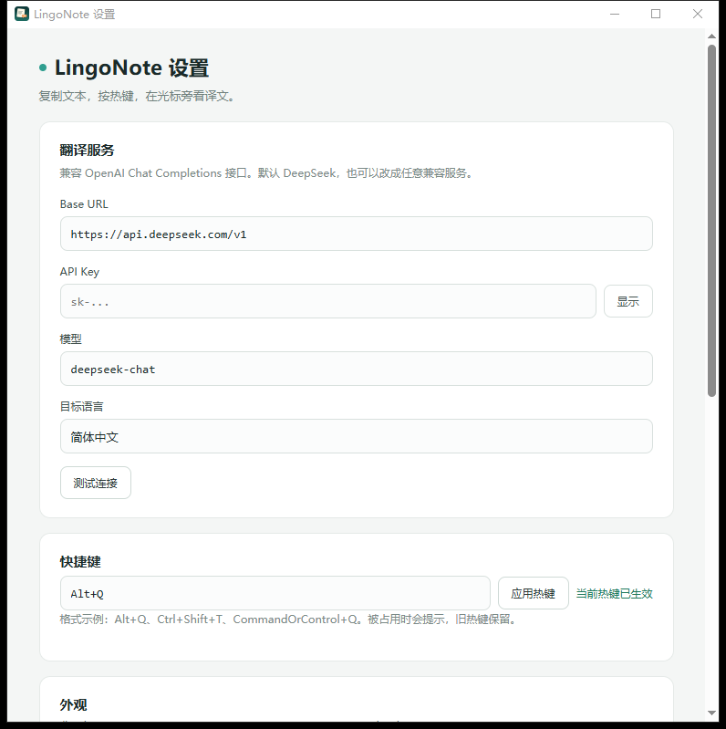

# LingoNote M1 验证记录

- 日期：2026-11-14
- 范围：安全存储、可配置热键、托盘、开机自启、外观持久化、复制恢复原剪贴板、错误文案、真实 DeepSeek
- 结论：**Windows M1 已验收并完成收尾**（真实 DeepSeek、热键修改/冲突、外观、复制恢复、自启、托盘菜单、注销/重启自启）；`debug_log` 已移除，8 个单元/集成测试通过；final 安装到正式用户目录；macOS 无设备可验证。

## 已实现

| 模块 | 实现 |
| --- | --- |
| API Key | keyring 3（Windows Credential Manager / macOS Keychain）；M0 明文 `api_key` 自动迁移并删除 |
| 热键 | Rust 侧 `global-shortcut` 注册；`set_hotkey` 可修改；新热键注册失败时保留旧热键；设置页显示状态 |
| 托盘 | 翻译剪贴板 / 设置 / 退出；左键菜单 |
| 开机自启 | `tauri-plugin-autostart`；设置页开关 |
| 外观 | 背景色、文字色、字体、字号、行高写入配置；便签通过 CSS 变量应用；设置页实时预览 |
| 行为 | 失焦隐藏、复制译文后 1 秒恢复原剪贴板 |
| 错误文案 | 401/403/404/429/5xx 映射为友好中文 |
| 设置页 | 热键、外观、行为、自启动、测试连接 |

## 已验证

| 验证项 | 结果 | 证据 |
| --- | --- | --- |
| Rust 编译（debug/release） | ✅ | `cargo build`、`cargo build --release` |
| 前端构建 | ✅ | `npm run build` |
| Windows Credential Manager 读写 | ✅ | `keyring_probe`：`keyring=probe-value` |
| M0 明文 Key 迁移 | ✅ | 启动后 JSON 中无 `api_key`；keyring 读到 `legacy-test` |
| 全局热键注册 | ✅ | 日志 `hotkey registered: Alt+Q` |
| 设置页渲染 | ✅ | 截图 `docs/images/m1-settings.png` |
| 首次无 Key 自动打开设置 | ✅ | final release 启动日志与窗口，进程 Responding=True |
| 托盘创建 | ✅（无报错） | 日志无 `tray setup failed` |
| NSIS 安装包 | ✅ | `LingoNote_0.1.0_x64-setup.exe`，约 5.74 MiB；release 启动正常 |
| 真实 DeepSeek 翻译 | ✅ | 38 字符 → 30 字符，1.4s；Base URL `https://api.deepseek.com` 可用 |
| 热键修改 UI | ✅ | 改为 `Ctrl+Shift+T` 后新热键生效；恢复 `Alt+Q` 后旧热键生效 |
| 热键冲突提示 | ✅ | 输入 `Alt+Tab` 提示“热键不可用（可能被其他程序占用）”，配置仍为旧热键 |
| 外观持久化/渲染 | ✅ | 用户设置 `#d26a6a` 背景 + `#2a2965` 文字，便签按配置渲染 |
| 复制后恢复剪贴板 | ✅ | 复制后立即为译文，约 1 秒后恢复原文；已恢复关闭状态 |
| 开机自启开关/登录启动 | ✅ | 关闭后 Run 项被删除，开启后写入当前 exe；用户确认注销/重启后正常启动 |
| 托盘菜单点击 | ✅ | 用户确认「翻译剪贴板 / 设置 / 退出」三个菜单项正常 |
| debug_log 移除 | ✅ | Rust/前端不再写 `%TEMP%\lingonote-debug.log`，命令已删除 |
| 单元/集成测试 | ✅ | `cargo test`：pure 6 + hotkey 2，共 8 个通过 |
| 正式安装/自启路径 | ✅ | 安装到 `%LOCALAPPDATA%\Programs\LingoNote`；自启 Run 项已指向该 exe |

## 验证截图

## 已知风险

- `keyring` 在 macOS 上首次访问可能触发 Keychain 授权提示；未真机验证。
- 热键修改是文本输入，不是按键录制；格式错误会提示。
- 设置窗口 780×760，小屏可能需滚动。
- 旧测试安装 `D:\ClipTonge\.tools\install-test\` 仍存在，可手动删除；正式自启已指向 `C:\Users\seatown\AppData\Local\Programs\LingoNote\lingonote.exe`。
- GNU 链接警告 `multiple non-default manifests` 仍在，不影响启动。

## 下一步

1. macOS 真机/云 Mac 验证：Keychain、全局热键、托盘、置顶、Retina。
2. 可选：删除旧测试安装 `D:\ClipTonge\.tools\install-test\`。
