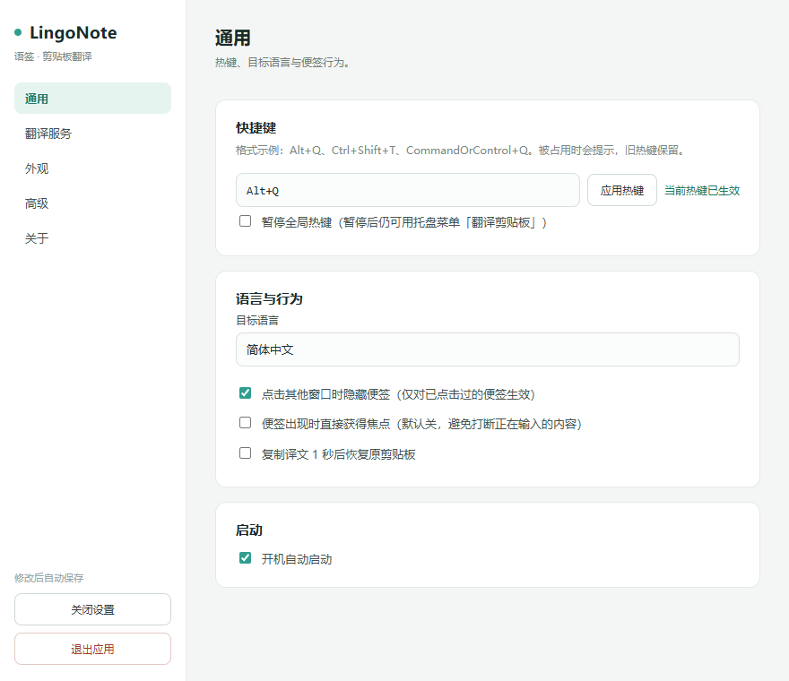
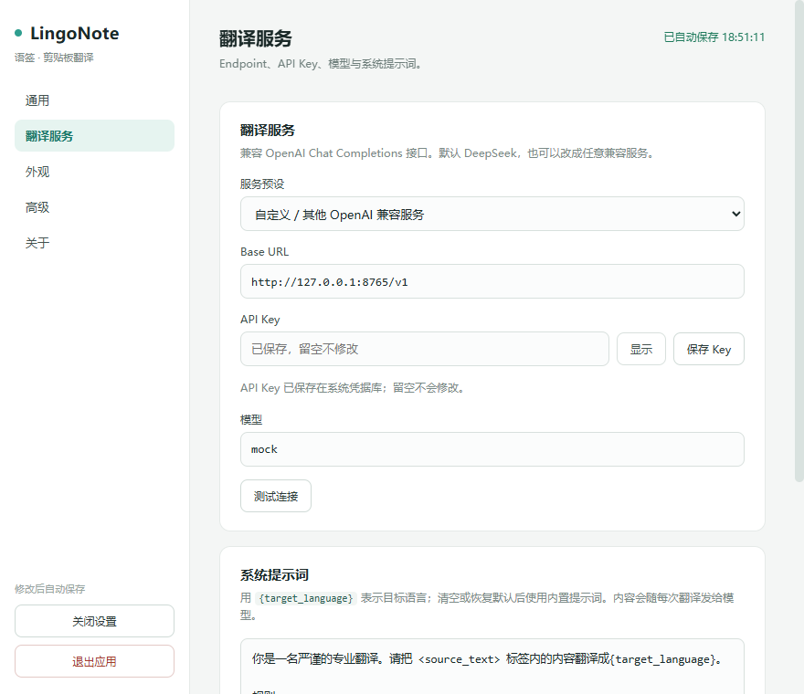
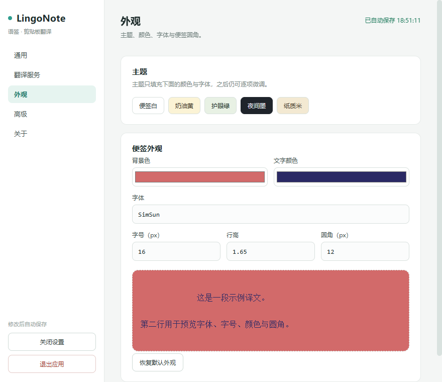
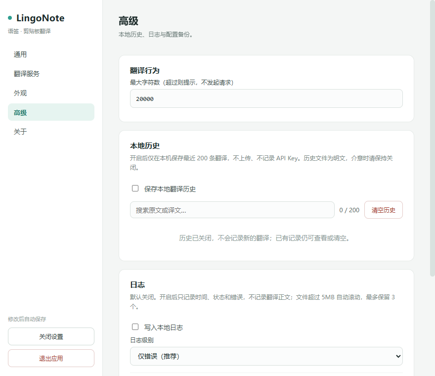
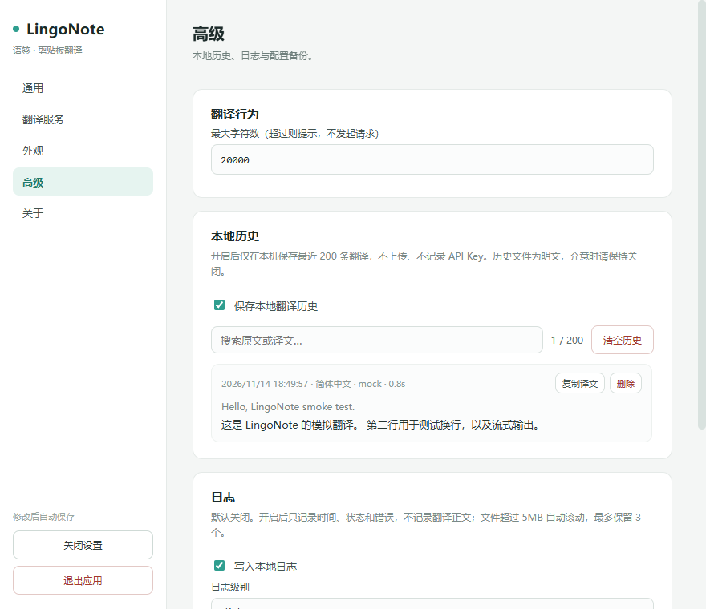
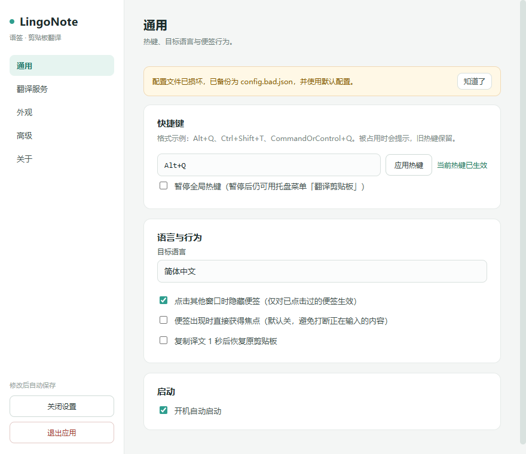

# LingoNote M2 验证记录

- 日期：2026-11-14
- 版本：0.2.0
- 范围：M2 Windows 增量（单实例、可编辑提示词、暂停热键、本地历史、配置导入/导出、滚动日志、配置原子写入与损坏恢复、设置页五分区与自动保存）
- 结论：**Windows M2 主体完成**。`cargo test` 16 个测试通过；release 与 NSIS 安装包构建成功；单实例、v1→v2 配置迁移、自动保存、mock 端到端翻译（历史 + 日志）、提示词持久化、暂停/恢复热键、导出/导入/恢复默认、配置损坏恢复均已验证。原生文件对话框与托盘菜单点击仍建议手动过一遍；macOS 未在真机验证。

## 已实现

| 模块 | 实现 |
| --- | --- |
| 单实例 | `tauri-plugin-single-instance`；第二次启动唤起已有设置窗口，不重复托盘 |
| 提示词 | `prompt.system` 可编辑，`{target_language}` 占位；空值回退内置模板；设置页可恢复默认 |
| 暂停热键 | 设置页与托盘 CheckMenuItem 双向同步；暂停时注销全局热键，托盘翻译仍可用 |
| 历史 | 默认关闭，最多 200 条；记录时间/原文/译文/目标语言/模型/耗时；搜索、复制、删除、清空；存 `history.json` |
| 导入/导出 | 导出 JSON 不含 API Key；导入校验版本/Base URL/模型，先备份 `config.backup.json` 再替换 |
| 日志 | 默认关闭，error/info/debug 三级；5MB × 3 滚动；不写正文；路径 app log dir |
| 配置可靠性 | 同目录临时文件 + `rename` 原子写入；解析失败备份 `config.bad.json`、默认值启动并提示 |
| 设置界面 | 通用/翻译服务/外观/高级/关于五分区；修改自动保存；主题预设、圆角、最大字符数、出现即聚焦 |
| 生命周期 | 设置窗口关闭=隐藏到托盘；托盘左键打开设置；开机自启状态与托盘勾选同步 |

## 已验证

| 验证项 | 结果 | 证据 |
| --- | --- | --- |
| Rust 单元/集成测试 | ✅ 16 个通过 | `cargo test`：pure 14 + hotkey 2 |
| 前端类型检查/构建 | ✅ | `npm run build`（tsc + vite） |
| release 构建 | ✅ | `LingoNote_0.2.0_x64-setup.exe`，5.95 MiB（6,241,276 字节） |
| NSIS 静默安装 | ✅ | 安装到 `%LOCALAPPDATA%\Programs\LingoNote`；exe ProductVersion/FileVersion 均为 0.2.0 |
| v1→v2 配置迁移 | ✅ | 旧配置补 `schema_version: 2`、radius、prompt/history/logging、max_chars；原有背景/文字色保留 |
| 单实例 | ✅ | 连续启动两次，进程数保持 1，已有「LingoNote 设置」窗口被唤起 |
| 设置页渲染 | ✅ | 5 个页面、侧边导航、自动保存提示；截图见下 |
| 自动保存 | ✅ | DOM 修改 Base URL/模型/历史/日志后约 2s，`config.json` 对应字段更新 |
| 提示词持久化/恢复 | ✅ | 自定义模板写入 `prompt.system`；点「恢复默认」后写回空字符串，提示“当前使用默认提示词” |
| mock 端到端翻译 | ✅ | 通过 IPC 调用 `start_translation`，mock SSE 返回 5 段流式文本；耗时 770ms |
| 本地历史 | ✅ | 开启后生成 `history.json`，含 28 字符原文、mock 译文、目标语言、模型、770ms；设置页显示 1/200 与记录行 |
| 日志 | ✅ | 开启 info 后写入 `app.log`：`settings saved`、`translation started… chars=28`、`translation done in 770 ms`；不含正文 |
| 暂停/恢复热键 | ✅ | IPC 返回 `paused:true` 且 `config.json` 的 `behavior.pause_hotkey` 同步；恢复后 `paused:false` |
| 导出配置 | ✅ | 导出 JSON 中 `api_key` 命中 0 次；包含 schema_version/exported_at/new fields |
| 导入配置 | ✅ | 导入后 Base URL、背景色 `#d26a6a`、文字色 `#2a2965` 恢复；生成 `config.backup.json` |
| 恢复默认设置 | ✅ | 配置回到默认（白底黑字、logging error、history off、hotkey Alt+Q），`has_api_key=true`（Key 保留） |
| 配置损坏恢复 | ✅ | 手动写入非法 JSON 后启动：生成 `config.bad.json`（原内容 13 字节），`config.json` 写回默认，设置页顶部显示损坏提示 |
| 开机自启状态读取 | ✅ | 设置页显示已开启；Run 项指向 `%LOCALAPPDATA%\Programs\LingoNote\lingonote.exe` |
| 测试后清理 | ✅ | 删除测试历史/日志/导出文件与 `config.backup.json`；恢复用户原配置与 0.1.0 时期的颜色设置 |

## 验证截图

设置 · 通用：

设置 · 翻译服务（含提示词编辑）：

设置 · 外观（主题与圆角）：

设置 · 高级：

本地历史记录：

配置损坏提示：

## 未验证 / 建议手动确认

- **原生文件对话框**：导出/导入的 `save`/`open` 窗口未在自动化中点击；命令层与文件结果已用 IPC 验证。建议手动点一次「导出配置」「导入配置」，确认取消、扩展名过滤与覆盖提示。
- **托盘菜单点击**：暂停热键、开机自启两个 CheckMenuItem 的实际点击与勾选刷新未自动化；后端状态与 IPC 已验证，建议右键托盘确认。
- **真实 DeepSeek**：本次端到端用本地 mock（不消耗额度）；真实接口在 M1 已验证，M2 未改请求协议（仅提示词来源可配置）。建议用真实 Key 再翻一条。
- **便签窗口视觉**：本次截图集中在设置页；便签的圆角/自定义提示词效果未单独截图，逻辑与配置已确认。
- **macOS**：无真机，未验证 Keychain、热键、托盘、单实例。

## 已知偏差与风险

- 历史使用 `history.json` 而非需求草案的 SQLite `history.db`；200 条规模下 JSON 足够，文件为明文，默认关闭。
- 日志目录为 `%LOCALAPPDATA%\com.lingonote.desktop\logs`（Tauri app log dir），不是草案的 `%LOCALAPPDATA%\LingoNote`。
- 配置导入先备份再替换，不提供“合并”模式；API Key 永不进入导出文件，导入时保留本机现有 Key。
- 未实现窗口透明度、位置记忆/固定锚点、自动更新、划词/OCR、界面多语言。
- 热键仍是文本输入 + 应用按钮，不是按键录制控件。
- GNU 链接警告 `multiple non-default manifests` 仍存在，不影响启动。

## 下一步

1. 手动点检原生文件对话框与托盘菜单（暂停/自启）。
2. 用真实 DeepSeek Key 复测一条，并确认便签圆角/提示词效果。
3. macOS 真机或云 Mac 验收（Keychain、热键、托盘、单实例、Retina）。
4. 评估是否补窗口透明度、位置记忆、自动更新等 P2 项。
5. 清理旧测试安装 `D:\ClipTonge\.tools\install-test\`。
