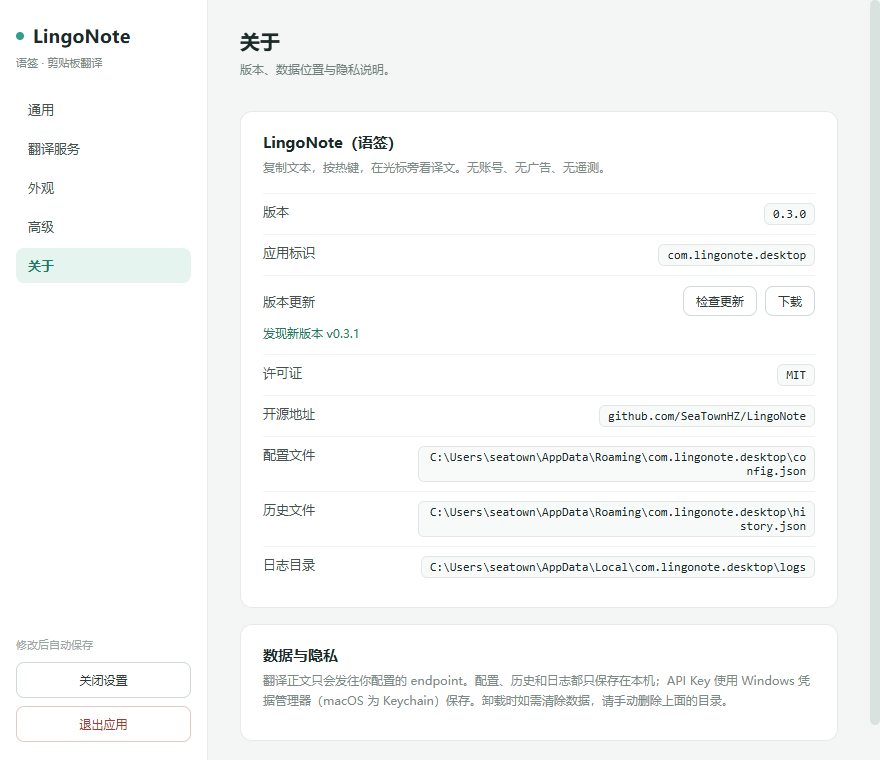

# M3 验证记录 · 更新与发布闭环（0.3.0）

- 里程碑：M3（2026-11-15）
- 验证对象：`git` 工作区（提交 `feat(M3): 更新检查与发布闭环`）
- 环境：Windows 11 + WebView2、Node 24、Rust stable（GNU 工具链）
- 结论：**静态闸 6/6 PASS，运行时 5/5 PASS，评审 P0/P1 = 0**

## 1. 静态闸（`project/accept.ps1`）

```
检查                   结果 说明
前端构建 npm run build PASS ✓ 12 modules transformed
Rust 测试 cargo test   PASS 通过 36 个（要求 >= 20）
生产构建 tauri build   PASS lingonote.exe 30.5 MB（Tauri CLI 生产构建）
配置契约静态检查       PASS 8 项关键字齐全
M3 契约静态检查        PASS 22 项关键字齐全
工作区待提交           PASS 16 个改动（验收后统一提交）
合计：PASS 6 / FAIL 0
```

M3 静态检查覆盖：三处版本号 0.3.0、`CHANGELOG.md`、`is_newer`/`normalize_version`、`UpdateInfo`、`check_update`/`open_release_page` 定义与 `invoke_handler` 注册、`check_updates` 默认 true、关于页 4 个新 id、`build.yml` 的 `tags-ignore`、`release.yml` 仅 tag 触发 + 资产缺失即失败、mock 两个更新端点。

## 2. 运行时烟测（mock 服务 + WebView2 CDP）

启动方式：`LINGONOTE_UPDATE_API=http://127.0.0.1:8765`，mock 由 `MOCK_TAG` 控制返回版本；每个场景独立重启应用。

| 场景 | 操作 | 结果 | 关键证据 |
|---|---|---|---|
| 有新版 | 手动检查，mock 返回 `v0.3.1` | PASS | 状态行「发现新版本 v0.3.1」，下载按钮出现；关于页版本 `0.3.0` |
| 已最新 | 手动检查，mock 返回 `v0.3.0` | PASS | 状态行「已是最新版本 0.3.0」，下载按钮隐藏 |
| 网络失败 | 手动检查，端点 `127.0.0.1:9` | PASS | 状态行「检查失败：连接更新服务失败…」，无弹窗、无崩溃 |
| 启动自动检查 | 开关开，启动后等 8s | PASS | mock `/stats` update 请求数 = 1；状态行「发现新版本 v0.3.1」；窗口未弹出 |
| 开关关闭 | 开关关，启动后等 8s | PASS | `/stats` = 0；随后手动检查 → `/stats` = 1，状态行正常 |

`open_release_page` 安全边界：

- `https://evil.example.com/x` → `拒绝打开非 GitHub 链接`（PASS）
- `https://github.com/SeaTownHZ/LingoNote/releases/tag/v0.2.0` → 调用成功，系统浏览器打开（PASS）



## 3. 单元测试（新增 11 个）

`src-tauri/tests/pure.rs` 新增 11 个测试、合计 34 个（另有 2 个热键测试）：

- 版本比较 8 组：`v` 前缀、`0.3` 与 `0.3.0` 相等、`0.3.0-rc1` 低于正式、`1.0.0 > 0.9.9`、`V0.10.0 > 0.9.9`、四段版本、非法输入（空串/`latest`/`0.3.x`/`0.3..1`/`v`/`0.3.0-`）。
- 配置 3 组：旧配置缺 `check_updates` 取 true、`false` 经归一化/导出/导入保持、`ConfigView` 序列化包含该字段。

## 4. 发布流水线

- `.github/workflows/build.yml`：`push`（`branches: ['**']`、`tags-ignore: ['v*']`）+ PR + 手动；产物缺失 `if-no-files-found: error`。
- `.github/workflows/release.yml`：仅 `v*` tag 触发；`contents: write`；Windows NSIS + macOS zip；`softprops/action-gh-release@v2` 建 **draft**，`fail_on_unmatched_files: true`。
- 演练：推送 `v0.3.0-rc1` → 见下节「CI 记录」。

## 5. 已知限制（本里程碑）

- 不检查应用内升级：只提示并跳转 Release 页，用户手动下载安装（PRD FR-13）。
- 启动检查失败静默（不打扰），仅手动检查显示失败原因。
- `LINGONOTE_UPDATE_API` 为烟测开关，只读环境变量，不进设置页、不写入配置。
- 更新检查为匿名 GitHub API（60 次/小时/ IP）；本应用启动最多 1 次、手动按需。
