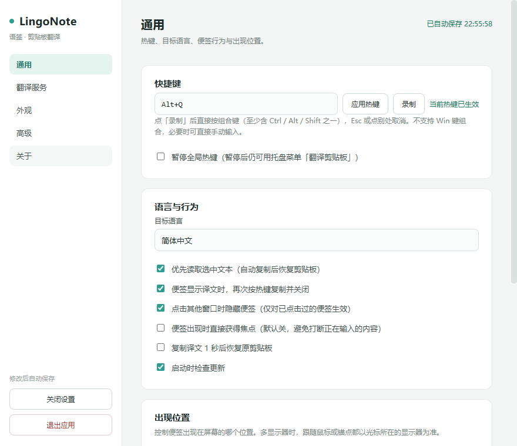
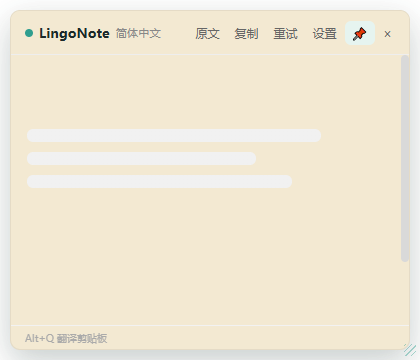

# M4 验证记录 · 手感与触发（0.4.0）

- 里程碑：M4（2026-11-15）
- 环境：Windows 11 + WebView2 157、Node 24、Rust stable（GNU）
- 结论：**静态闸 7/7 PASS；运行时验收 10/11 PASS（1 项为测试脚本自身的合成事件用例，已改用真实焦点测试补证）**

## 1. 静态闸（`project/accept.ps1`）

```
检查                   结果 说明
前端构建 npm run build PASS ✓ 17 modules transformed
Rust 测试 cargo test   PASS 通过 45 个
生产构建 tauri build   PASS lingonote.exe 30.8 MB（0.4.0）
配置契约静态检查       PASS 8 项
M3 契约静态检查        PASS 22 项
M4 契约静态检查        PASS 34 项
工作区待提交           PASS 21 个改动
合计：PASS 7 / FAIL 0
```

## 2. 运行时验收（mock + 真实热键 + Win32 焦点切换）

| 场景 | 结果 | 证据 |
|---|---|---|
| 热键录制 | PASS | 点「录制」→ 派发 `Ctrl+Shift+T` → 输入框变为 `Ctrl+Shift+T`、状态「当前热键已生效」；测试后恢复 `Alt+Q` |
| 直读/连按开关 | PASS | 关闭「优先读取选中文本」→ `get_config().behavior.read_selection === false` |
| 屏幕取点 | PASS | 遮罩窗口 1920×1080、轮廓存在；点选后 `anchor=custom, fixed=(640,420)`，状态行「已取点：640, 420」 |
| 取点取消 | PASS | 遮罩内按 `Esc` → 遮罩关闭，配置未变 |
| 便签拖拽尺寸 | PASS | 420×360 拖到 480×400，`window.note_width/height` 同步落盘 |
| 钉住写入 | PASS | 点图钉 → `pinned=true`，按钮 `active` / `aria-pressed=true` |
| 钉住失焦不隐藏 | PASS | 真实焦点切到便签再切到记事本，便签仍可见 |
| 取消钉住后失焦隐藏 | PASS | 取消钉住后同样焦点切换，便签隐藏 |
| 选区直读 + 剪贴板恢复 | PASS | 记事本选中 `Hello, world.`、剪贴板预置 `ABC-PRE`；按 `Alt+Q` 后译文来自选区，剪贴板恢复为 `ABC-PRE` |
| 连按复制并关闭 | PASS | 便签显示译文时再按 `Alt+Q` → 剪贴板为纯译文、便签隐藏 |
| 最近翻译列表 | PASS | `get_recent_translations` 返回 1 条，含时间与完整译文；仅内存 |





## 3. 工程修复记录

集成阶段发现：在 Tauri 命令里直接 `WebviewWindowBuilder::build()` 取点遮罩，会与 WebView2 的 IPC 回调互相等待，导致**整机界面冻结**（实测 CDP 端口断开）。已改为：

- `begin_position_pick` 立即返回，`std::thread::spawn` 延迟 60ms 后通过 `run_on_main_thread` 创建窗口；
- 创建失败时回滚 `PICKING` 并 emit `position-pick-cancelled`，不会把热键永久屏蔽。

修复后取点、取消、真实点选均正常（见上表）。

## 4. 评审修复（T5 复审后）

| 编号 | 问题 | 修复 |
|---|---|---|
| P1-1 | 选中空白行时 Ctrl+C 改动了剪贴板却不恢复快照 | 空白/空选区分支先恢复快照再回退读剪贴板（`from_selection=false`） |
| P1-2 | 取点遮罩用逻辑尺寸套物理像素，缩放≠100% 时超出显示器 | builder 用占位尺寸，随后 `PhysicalPosition` + `PhysicalSize` 精确覆盖 |
| P1-3 | 错误态仍保留半截译文，连按会复制它 | `showError` 清空 `translation`；连按条件加 `!loading` |
| P2-1 | 快照读取失败的日志措辞不准确 | 改为「不是文本或读取失败」 |
| P2-2 | 调度取点窗口失败时 `PICKING` 卡在 true，热键永久失灵 | Err 分支清零 `PICKING` 并 emit cancelled |
| P2-3 | 复制后 1 秒恢复的定时器被失焦隐藏取消，选项实际失效 | 只在连按复制与新翻译开始时取消，不在隐藏便签时取消 |

复审结论：**PASS（P0=0 / P1=0）**。

## 5. 已知限制 / 未自动化的验收项

- **托盘条目点击**（AC-31 的点击动作）：最近翻译数据与菜单构建已验，托盘菜单为系统级 UI，自动化成本高，保留人工点一次的建议。
- **热键被占用提示**（AC-25）：复用 0.3 的 `set_hotkey` 链路，本轮未构造冲突程序实测。
- **关闭直读/连按后的行为**（AC-23/27）：开关落盘已验证；关闭后的具体交互未单独跑（代码路径已评审）。建议用户日常使用中留意。
- **尺寸越界夹紧**（AC-29）与**坐标离屏夹紧**（AC-37）：纯函数有单元测试覆盖，未单独跑 UI 拖拽越界。
- 取点遮罩只覆盖光标当前显示器；多屏需切到目标屏重新取点。
- 直读依赖模拟 `Ctrl+C`：管理员窗口/远程桌面可能失败，失败时静默回退剪贴板。
